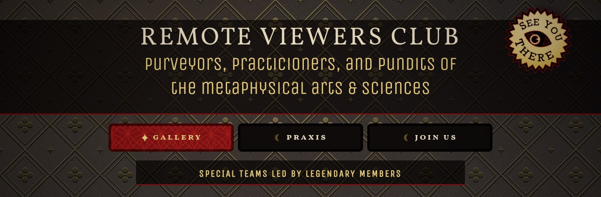
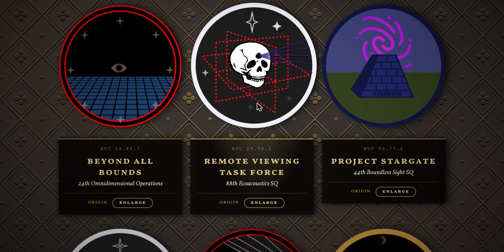
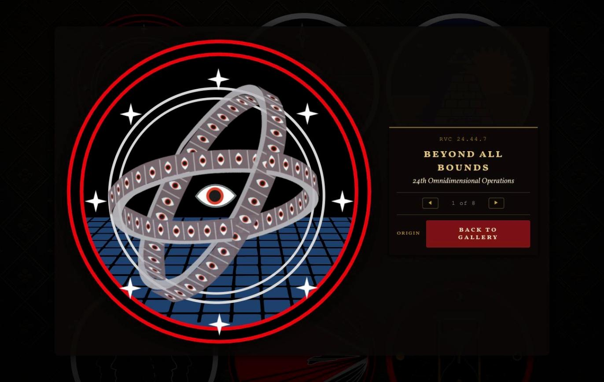
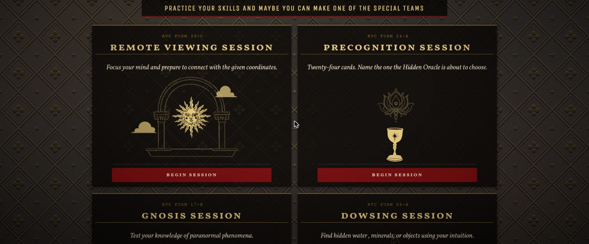
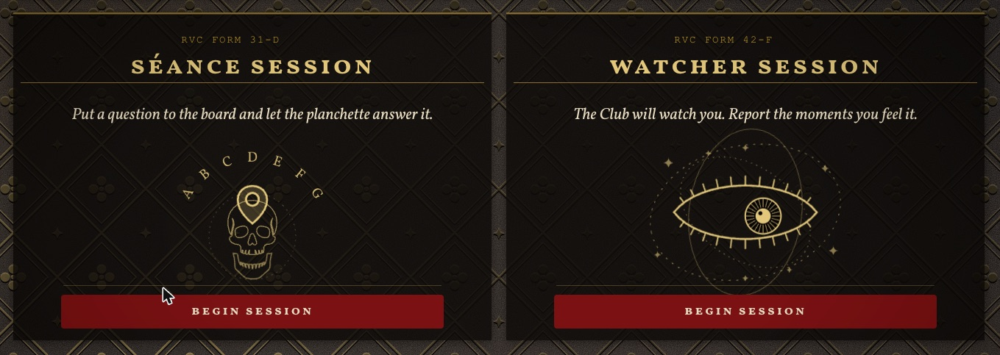
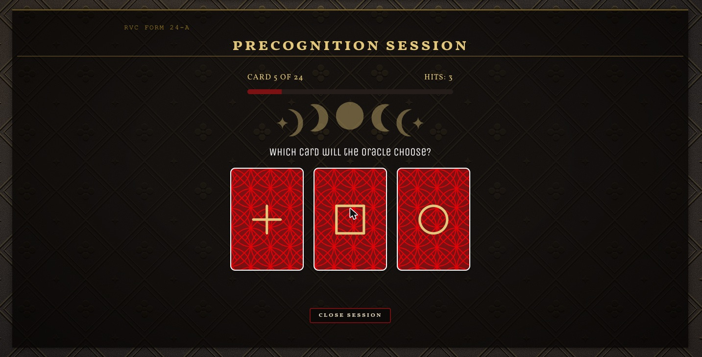
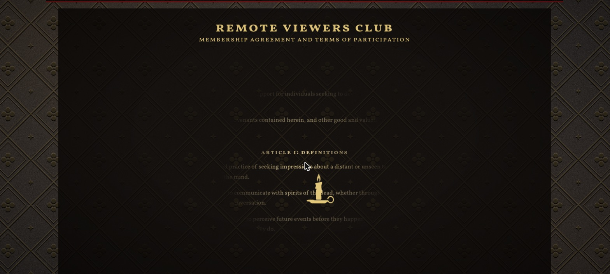
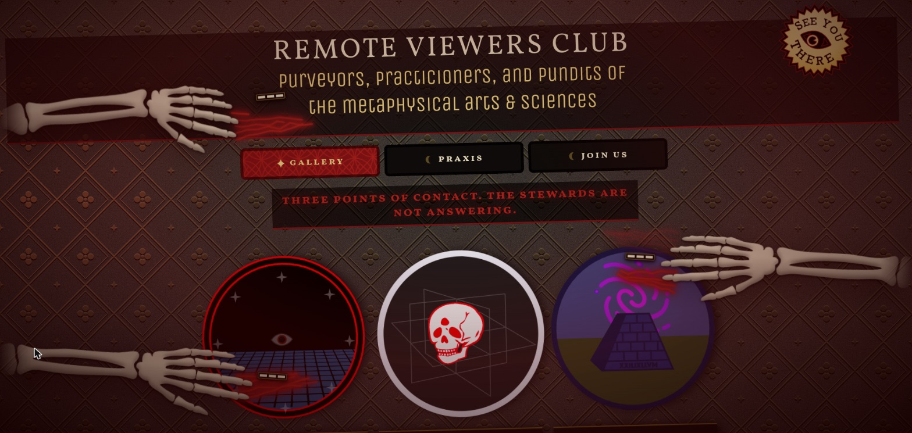

# Remote Viewers Club

### Purveyors, practicioners, and pundits of the metaphysical arts & sciences



A single-page Vue 3 application bound as an occult tome. Inside: a gallery of eight
animated mission patches, six parapsychology tests that score you honestly, and a
membership agreement legible only by candlelight.

The conceit is an agency that files its séances. Every badge is a specimen with an
accession number; every test is a numbered form; the whole thing is tooled, gilt and
lit by a flame that follows your cursor. None of it is photographed — the patches,
the ornaments and the binding itself are drawn by the page, in SVG and CSS. The only
real photographs in the app are the remote-viewing targets, which are supposed to be
photographs.

---

## The Gallery

Eight patches, each a self-contained component that animates in place and enlarges
onto a specimen plate you can read. The accession line files each specimen under the
praxis form that produced it: `RVC 24.44.7` belongs to `RVC FORM 24-A`. Nothing in
the number resolves to a date, which is the point — a real registry is unknowable
because you do not hold the key.



| № | Specimen | Unit |
|---|---|---|
| RVC 24.44.7 | Beyond All Bounds | 24th Omnidimensional Operations |
| RVC 09.08.2 | Remote Viewing Task Force | 88th Ecoacoustics SQ |
| RVC 09.77.4 | Project Stargate | 44th Boundless Sight SQ |
| RVC 17.68.5 | PSYWACs | 960th Psychological Warfare SQ |
| RVC 42.02.9 | Vigilance and Speed | 3rd Special Interceptor SQ |
| RVC 24.60.3 | See You Yesterday | 37th Temporal Reconaissance Wing |
| RVC 31.13.6 | Infinite Broadcast | 227th Silent Spectral Comms |
| RVC 06.51.1 | Electronic Phantoms | 9716th Radar Decoy SQ |

Enlarging opens a native `<dialog>` — Esc, the focus trap and returning focus to the
badge you came from are the platform's job, not ours. The close-up steps through the
collection without closing.



---

## Praxis

Six sessions. Each sits folded as a card showing its form number, its title and one
sentence, and widens once you begin.



| Form | Session | What it asks of you |
|---|---|---|
| RVC FORM 06-B | Dowsing | Find hidden water, minerals, or objects using your intuition. |
| RVC FORM 09-C | Remote Viewing | Focus your mind and prepare to connect with the given coordinates. |
| RVC FORM 17-E | Gnosis | Test your knowledge of paranormal phenomena. |
| RVC FORM 24-A | Precognition | Twenty-four cards. Name the one the Hidden Oracle is about to choose. |
| RVC FORM 31-D | Séance | Put a question to the board and let the planchette answer it. |
| RVC FORM 42-F | Watcher | The Club will watch you. Report the moments you feel it. |



**Nothing is rigged to make you look psychic.** The precognition run reports your
hits against the number expected by chance, with the deviation and a standard score,
and keeps a lifetime record across runs. The Oracle selects only *after* your call is
recorded, so any agreement is precognition rather than mere clairvoyance. The séance
measures how far the planchette travelled and how much of that was your own hand.



---

## Join Us

The membership agreement runs to thirteen hundred words of straight-faced legalese
and sits in the dark. You read it by carrying the candle across it, a line or two at a
time.



Sign it and your name goes onto the roll, which is a Google Apps Script sheet behind
the scenes and a gallery of real signatures in front of it. The club counts the
signatures that precede yours rather than inventing a number.

---

## The Room

Most of what makes the page feel inhabited is not in any one view:

- **The candle is carried.** A gilt pass over the tooled binding is masked to the
  pointer and eases toward it rather than snapping, so the gold catches where you
  actually are. It is a property of the room, not of a component.
- **Something in the binding is watching.** Every so often — rarely enough that you
  are not sure you saw it — one quatrefoil in the lattice opens into an eye, holds,
  and closes. It lands on the tooling grid, so it reads as part of the binding.
- **The room notices absence.** Leave the tab and the club says so in the title. Go
  genuinely still and the vignette closes in and the candle gutters.
- **The seal follows you.** Scroll down and the SEE YOU THERE seal detaches after a
  beat and drifts down to keep watching, then flies home. Certain the first
  time, and thirty percent of the time after that.
- **Something else wants in.** Type `bones`.



Every one of these checks `prefers-reduced-motion` first. Skeleton arms lunging out
of the page is precisely what that setting is for, and there is no tasteful reduced
version, so there is none.

---

## Running it

```sh
npm install
npm run serve   # dev server with hot reload
npm run build   # production build into dist/
npm run lint    # lint and fix
```

`build` sets `NODE_OPTIONS=--openssl-legacy-provider` for Webpack 4-era hashing on
modern Node.

## Built with

Vue 3 and Vue CLI 5, with no runtime dependencies beyond `vue` and `core-js`. Badges,
icons, session animations and ornaments are hand-written SVG; the binding, the grain
and the candlelight are generated in CSS.

Set in **Vollkorn**, with **Unica One** for the display lines and a typewriter face
kept for the coordinates. The two bundled families are subset to woff2: four faces,
92 KB in total.

```
src/
  components/
    Badge1–8.vue          the specimens
    animations/           line-art intros for the praxis cards
    sessions/             the six tests
    SeeYouThere.vue       the seal, and the eye that tracks you
    SkeletonArms.vue      the siege
    Join.vue              the agreement
  composables/            the room: candlelight, presence, sheen, the watching lattice
  styles/                 palette, typography, buttons, motion
  data/                   targets, trivia, verdicts, board glyphs
```

## Colophon

Built by [Jason M. Harrison](https://www.drinkingtheink.com/). Badges after military
and astronomical mission patches; origin links sit on every specimen plate.

*Remote Viewers Club · bound in the year 2026*
